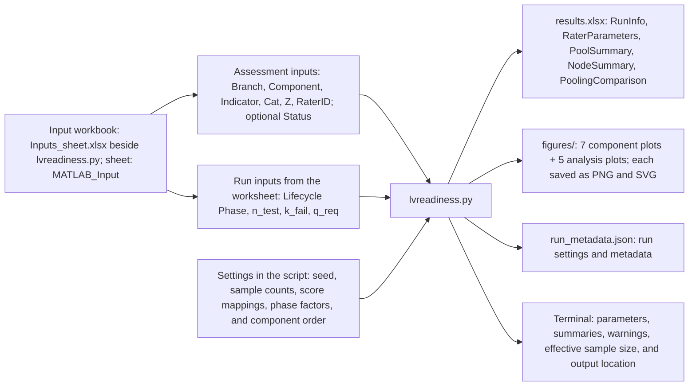

# LVReadiness: flowchart and inputs/outputs

Guide to [lvreadiness.py](lvreadiness.py). Section numbers below match the numbered `# %%` headings in the script.

The script reads assessment scores, builds probability distributions, runs a Monte Carlo analysis, updates the results using test evidence, and saves figures and tables.

## 1. Execution flowchart

```mermaid
flowchart TD
    Start(["Start lvreadiness.py"])
    Setup["Sections 1–6: import libraries and define paths, sample counts, and mappings"]
    Read["Section 8: read only the MATLAB_Input worksheet"]
    Settings["Sections 9–10: read lifecycle phase, n_test, k_fail, and q_req"]
    Clean["Section 11: clean text, standardize component names, and mark unassessed rows"]
    Valid{"Are inputs valid?"}
    Stop["Stop and report the input error"]
    Profiles["Section 12: for each component and rater, exclude unassessed rows and average T and O scores separately"]
    Beta["Sections 13–15: map scores to mu_T, m_O, and s_O; calculate mu, strength, alpha_p, and beta_p"]
    Component["Section 16: select the next component and give its profiles equal weights"]
    Moments["Calculate mixture mean, within-rater variance, between-rater variance, and reporting approximation"]
    Sample["For each prior draw, select a profile and sample its success Beta distribution; convert p to q = 1 - p"]
    More{"More components?"}
    Tree["Section 17: combine component failures through the design, implementation, operation, and top-event OR gates"]
    Likelihood["Section 18: use top-event test evidence to calculate posterior weights"]
    Supported{"Does any prior sample support the evidence?"}
    NoSupport["Stop: no prior sample supports the test evidence"]
    Resample["Calculate effective sample size and resample whole rows using the posterior weights"]
    Summary["Section 19: summarize prior and posterior results for all 11 nodes"]
    Comparison["Section 20: separately run the average-score method and compare top-event results"]
    Plots["Sections 21–22: create a new run folder and save component and top-event plots"]
    Save["Section 23: save results.xlsx and run_metadata.json"]
    Finish(["Print the output folder and finish"])

    Start --> Setup --> Read --> Settings --> Clean --> Valid
    Valid -- "No" --> Stop
    Valid -- "Yes" --> Profiles --> Beta --> Component --> Moments --> Sample --> More
    More -- "Yes" --> Component
    More -- "No" --> Tree --> Likelihood --> Supported
    Supported -- "No" --> NoSupport
    Supported -- "Yes" --> Resample --> Summary --> Comparison --> Plots --> Save --> Finish
```



The input checks are grouped into one decision to keep the chart readable. In the code, checks occur throughout sections 8–12, including while each rater profile is prepared. Invalid files, missing columns, invalid scores, duplicate indicators, and profiles without both T and O scores stop the run. Rows explicitly marked **Unable to assess** are excluded with a warning; their score cells must be blank.

The effective sample size check warns if too few prior samples contribute meaningfully to the posterior. The average-score comparison runs separately; it does not change the primary exact-pool results.

## 2. Input/output chart



### Workbook inputs

The current `input_file` setting points to [Inputs_sheet.xlsx](Inputs_sheet.xlsx) beside the script. `Indicators_Definition_v2.xlsx` is provided as a reference and is not read by the script.

| Column | Meaning | Used for |
|---|---|---|
| `Branch` | Design, Implementation, or Operation | Check that the component belongs to the correct branch. |
| `Component` | Component being assessed | Group scores and assign the component's fault-tree event. |
| `Indicator` | Name of the assessed indicator | Identify assessments and detect duplicates within a component/rater pair. |
| `Cat` | `T` for technical or `O` for organizational | Separate the two kinds of scores before averaging. |
| `Z` | Score from 0 to 4 | Calculate each profile's average technical and organizational scores. |
| `RaterID` | Person who supplied the assessment | Keep different people's profiles separate. |
| `Status` (optional) | `Unable to assess` explicitly marks an unscored row | Exclude that row; its `Z` must be blank. Other status text does not exclude it. |
| `Lifecycle Phase` | SFR, PDR, CDR, TRR, or SVR | Select the strength multiplier `lambda_phase`. |
| `n_test` | Total number of tests | Calculate the evidence likelihood. Must be a nonnegative integer. |
| `k_fail` | Number of failed tests | Calculate the evidence likelihood. Must be an integer from 0 to `n_test`. |
| `q_req` | Maximum acceptable top-event failure probability | Report the probability of meeting or exceeding the requirement. Must be from 0 to 1. |

The lifecycle phase and each test setting may appear once or repeat down the worksheet. All nonblank entries for a setting must agree. Phase names are compared without regard to capitalization.

### Settings defined in the script

| Setting | Current value | Meaning |
|---|---|---|
| `random_seed` | `1` | Makes Python runs repeatable with the same environment and inputs. |
| `n_prior` | `200_000` | Number of prior probability draws. |
| `n_posterior` | `50_000` | Number of posterior resamples. |
| `score_levels` | `[0, 1, 2, 3, 4]` | Score positions used for linear interpolation. |
| `mu_t_levels` | `[0.40, 0.60, 0.75, 0.88, 0.96]` | Technical score to base mean success probability. |
| `m_o_levels` | `[0.90, 0.99, 1.03, 1.07, 1.10]` | Organizational score to mean multiplier. |
| `s_o_levels` | `[4, 8, 12, 16, 20]` | Organizational score to base Beta strength. |
| `lambda_levels` | `[0.7, 1.0, 1.3, 1.6, 2.0]` | Strength multipliers for SFR, PDR, CDR, TRR, and SVR, respectively. |

### Main intermediate inputs and outputs

| Sections | Receives | Produces |
|---|---|---|
| 8–11: load and clean | Workbook and script settings | Cleaned `input_table`, `phase_name`, `lambda_phase`, `n_test`, `k_fail`, `q_req`. |
| 12: prepare profiles | Assessment rows grouped by component and rater | `rater_table` with `Z_T`, `Z_O`, and input/used/excluded row counts. |
| 13–14: calculate Beta parameters | Profile scores and mapping settings | `mu_T`, `m_O`, `s_O`, `mu`, `strength`, `alpha_p`, `beta_p`. |
| 16: pool and sample | Rater Beta parameters and equal weights | `pool_summary` and `q`, an array with `n_prior` rows and 7 component columns. |
| 17: fault tree | The 7 component failure-probability columns | `q_design`, `q_implementation`, `q_operation`, and `q_top`. |
| 18: Bayesian update | `q_top` and test evidence | `posterior_weights`, `effective_sample_size`, and jointly resampled component/branch/top-event arrays. |
| 19: summarize nodes | Prior and posterior arrays; `q_req` | `node_summary`, containing 11 rows for the 7 components, 3 branches, and top event. |
| 20: comparison | Equal-profile average scores and the same test evidence | Average-score samples and `pooling_comparison`. |
| 21–23: plot and save | Parameters, samples, summaries, and settings | Figures, Excel workbook, JSON settings/metadata, and terminal output. |

## 3. Saved output files

Each successful run creates a new timestamped folder:

```text
Singular Python Script/
└── outputs/
    └── run_YYYYMMDD_HHMMSS_mmm/
        ├── results.xlsx
        ├── run_metadata.json
        └── figures/
            ├── pool_concept.png / .svg
            ├── pool_design_verification.png / .svg
            ├── pool_manufacturing.png / .svg
            ├── pool_assembly_and_integration.png / .svg
            ├── pool_impl_verification.png / .svg
            ├── pool_operation_setup.png / .svg
            ├── pool_operation_execution.png / .svg
            ├── 01_prior_q_top.png / .svg
            ├── 02_posterior_q_top.png / .svg
            ├── 03_prior_vs_posterior.png / .svg
            ├── 04_prior_posterior_likelihood.png / .svg
            └── 05_legacy_vs_exact_pool.png / .svg
```

Each `.png / .svg` entry represents two separate files. PNG files use Matplotlib's default resolution. SVG files are vector copies; they replace MATLAB's native FIG output in this Python version.

| Worksheet in `results.xlsx` | Contents |
|---|---|
| `RunInfo` | Input location, output folder, sample counts, seed, mappings, lifecycle phase, evidence, effective sample size, and assessment counts. |
| `RaterParameters` | One row per component/rater profile, including average scores, Beta parameters, row counts, and assigned pooling weight. |
| `PoolSummary` | One row per component: exact mixture moments, within/between variance, and moment-matched Beta approximation. |
| `NodeSummary` | Prior/posterior sample counts, means, standard deviations, medians, percentiles, and top-event requirement probabilities. |
| `PoolingComparison` | Top-event statistics comparing averaged scores with the exact equal-weight distribution pool. |

`run_metadata.json` stores the same run settings and metadata as `RunInfo` in one machine-readable text file. Raw Monte Carlo sample arrays remain in memory during execution; this script does not export them.

## 4. How to read the results

- **`p`** is a component's success/readiness probability. Component-pool plots use this horizontal axis.
- **`q = 1 - p`** is failure probability. Fault-tree arrays and top-event plots use failure probabilities.
- **Prior** means before applying the test evidence. **Posterior** means after applying it.
- Each Monte Carlo row is a possible set of probabilities, not one simulated physical launch.
- The likelihood curve displays the test evidence alone, normalized over the plotting grid. It is not the posterior density.
- `q_req` is a top-event requirement. Requirement probabilities for other nodes are intentionally left blank in Excel.
- Moment-matched Beta parameters summarize a mixture for reporting. Sampling uses the original rater distributions with equal weights.
