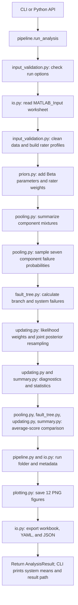
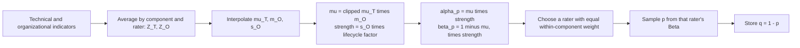
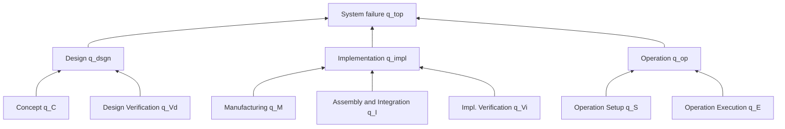
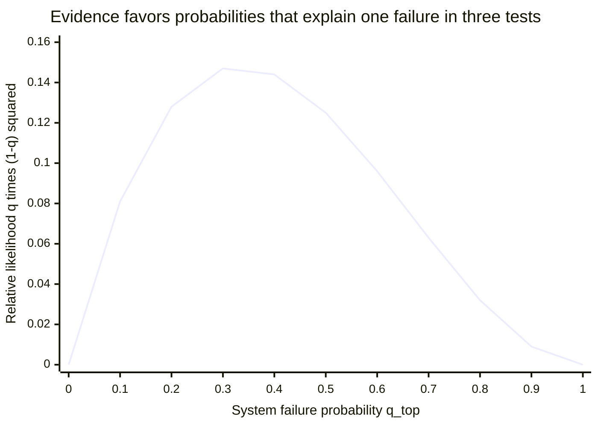

# LVReadiness: code workflow guide

Based on GitHub branch **review/readability-audit**, inspected October 15, 2026. [Source repository](https://github.com/ykwang6126/Launch-Vehicle-Readiness-Estimation/tree/review/readability-audit).

The program converts assessment scores into uncertain component success probabilities, combines component failure probabilities into a system failure probability, and updates that uncertainty using observed test results.

## 1. Where execution starts

```text
Command line: python -m lvreadiness run INPUT.xlsx --output outputs
             __main__.main() → pipeline.run_analysis()

Python API:   from lvreadiness import run_analysis
             run_analysis("INPUT.xlsx", "outputs") → same pipeline
```

The files under `src/` are modules: the pipeline calls their functions; it does not launch each file as a separate script. `config.py` supplies constants and `Settings`. `__init__.py` preserves the public API. The CLI now lives in `__main__.py`; the installed `lvreadiness` command calls the same `main` function. The execution guard prevents an import from starting the CLI. Defaults are 200,000 prior draws, 50,000 posterior draws, and seed 1.

## 2. Full execution flow



This is the actual execution order: the comparison calculation runs after the main posterior and before output files are written.

## 3. Step-by-step calls and data

Let **R** be the number of component–rater profiles, **N** the prior draw count, and **M** the posterior draw count.

| Step | Module / function called | What happens and what comes out |
|---:|---|---|
| 1 | `input_validation.validate_run_options` | Require positive integer N and M, and a nonnegative integer seed. Resolve the workbook path. |
| 2 | `io.read_input` | Read stored Excel values from `MATLAB_Input`; check file, sheet, and headers. Return a raw DataFrame. |
| 3 | `input_validation.validate_input` | Check settings and identifiers; standardize names; exclude “Unable to assess” indicators from scores; require scored T and O indicators per profile. Average T/O scores separately. Return cleaned rows, **R × 8** profiles, `Settings`, and excluded Excel row numbers. |
| 4 | `priors.build_priors` → `parameters` | Map scores into Beta parameters; assign equal weights within each component. Return **R × 16** profiles. |
| 5 | `pooling.summarize_pools` → `mixture_moments` | Report each component's mixture mean and within/between-rater variance. Return seven pool-summary rows. Moment-matched Betas are reporting approximations. |
| 6 | `pooling.sample_components` | Create seeded PCG64 generator in the pipeline. For each component and draw, select a rater, sample success `p` from its Beta, and store failure `q = 1 - p`. Return **N × 7**. |
| 7 | `fault_tree.fault_tree_nodes` | Compute three branch failures and `q_top`: **N × 4**. Pipeline joins these to the seven component columns, giving **N × 11** prior samples. |
| 8 | `updating.posterior_weights` → `input_validation.validate_evidence` | Use each prior `q_top` and observed tests/failures to calculate a normalized likelihood weight. Return **N** weights. |
| 9 | `updating.resample_joint` | Select M complete prior rows with replacement using those weights. Return **M × 11** posterior samples, M source indices, and effective sample size (ESS). |
| 10 | `updating.weighted_moments`; `summary.summarize_nodes` | Calculate weighted posterior diagnostics and prior/posterior statistics. `NodeSummary` has **11 × 19** entries. Requirement probabilities apply only to `q_top`. |
| 11 | Comparison calls below | Calculate the older average-score method separately and compare it with the main method. Return two `PoolingComparison` rows. |
| 12 | `pipeline._create_run`; `io.git_commit`; `io.sha256` | Create a timestamped run directory; collect settings, versions, code commit if available, input fingerprint, and diagnostics. |
| 13 | `plotting.plot_results` | Write seven component success-density plots and five system failure-probability plots. |
| 14 | `io.export_results` | Write five workbook sheets, configuration YAML, and metadata JSON. Pipeline returns samples, tables, diagnostics, and paths in `AnalysisResult`. |

`validate_input` uses `clean_text`, `standardize_component_name`, and its nested `read_consistent_setting` helper. `Settings.lambda_phase` looks up the workbook's lifecycle factor in `config.py`.

## 4. What happens inside the main calculations

### Score → success prior → failure samples



`mu` is clipped to `[0.01, 0.99]`. Higher strength narrows the Beta distribution at a fixed mean. One rater assessing all seven components produces seven profiles, each with weight 1.0. Sampling still produces N rows of uncertain probabilities.

### Component → system failure graph



Each gate uses `q_gate = 1 - product(1 - q_input)`. The component priors are sampled independently. Every sample row contains seven component probabilities, three branch probabilities, and one system probability, in that order.

### Test evidence → posterior

For prior row i, the code assigns weight proportional to:

```text
q_top[i] ** k_fail × (1 - q_top[i]) ** (n_test - k_fail)
```

It calculates this in log space, subtracts the largest log likelihood for stability, and normalizes the weights to sum to one. Whole rows are resampled together, preserving the dependence induced by the update. With no tests, weights are equal; finite resampling can still introduce sampling variation.

The graph below illustrates the likelihood for **one failure in three tests**. It is a calculated example, not a run result or a posterior density. Values are proportional to weights before normalization; the common binomial coefficient is omitted, as in the code.



For example, a prior row with `q_top = 0.3` gets more weight than one with `q_top = 0.9` for this evidence. The final posterior also depends on which probabilities the prior contains. ESS measures how broadly the weights are spread; `resample_joint` warns when ESS is below 1% of N.

## 5. Comparison path: called after the main summary

```text
pooling.sample_averaged_scores
  → priors.parameters (one Beta from average T/O scores per component)
  → fault_tree.fault_tree_nodes (retain q_top)
  → updating.posterior_weights
  → rng.choice (resample the comparison's q_top values)
  → summary.pooling_comparison
```

These comparison samples do not feed the main prior or posterior. All random sampling uses the pipeline's single generator. The primary method samples the full rater mixture, rather than the moment-matched Beta shown in comparison plots.

## 6. Outputs and supporting code

```text
outputs/run_<timestamp>/
├── results.xlsx
│   ├── RunInfo
│   ├── RaterParameters
│   ├── PoolSummary
│   ├── NodeSummary
│   └── PoolingComparison
├── figures/                 # 7 component + 5 system PNGs
├── run_config.yaml          # resolved analysis settings
└── run_metadata.json        # provenance and weighted diagnostics
```

`plot_results` uses `_figure` and `_save`; it calls `posterior_weights` again to draw a normalized likelihood curve. That plotting call does not update the samples. `summarize_nodes` uses Hazen percentiles and population standard deviations; `q_req` controls reported system requirement probabilities, not likelihood weights.

| Supporting file / folder | When used |
|---|---|
| `config.py` | Imported for score maps, lifecycle factors, component/node order, defaults, and `Settings`. |
| `pooling.success_product_moments` | Optional exact-moment helper; not called by the normal `run_analysis` workflow. |
| `tools/build_synthetic_example.py` | Run explicitly to create the fictional workbook before an analysis. |
| `tools/export_matlab_reference.m` | Run explicitly with local MATLAB reference code to produce comparison data. |
| `tools/verify_matlab.py` | Run explicitly after MATLAB/Python outputs exist to check their agreement. |
| `tests/` | Run explicitly with pytest; unit, integration, and optional historical regression checks. |

On invalid input, functions raise errors; the CLI catches `ValueError` and `OSError`, prints the message, and returns exit code 2. On success it prints prior/posterior mean `q_top` and the results path, then returns 0.

## Source links

- [Pipeline and call order](https://github.com/ykwang6126/Launch-Vehicle-Readiness-Estimation/blob/review/readability-audit/src/pipeline.py)
- [Input validation](https://github.com/ykwang6126/Launch-Vehicle-Readiness-Estimation/blob/review/readability-audit/src/input_validation.py), [prior construction](https://github.com/ykwang6126/Launch-Vehicle-Readiness-Estimation/blob/review/readability-audit/src/priors.py), [pooling and sampling](https://github.com/ykwang6126/Launch-Vehicle-Readiness-Estimation/blob/review/readability-audit/src/pooling.py)
- [Fault tree](https://github.com/ykwang6126/Launch-Vehicle-Readiness-Estimation/blob/review/readability-audit/src/fault_tree.py), [Bayesian update](https://github.com/ykwang6126/Launch-Vehicle-Readiness-Estimation/blob/review/readability-audit/src/updating.py)
- [Summaries](https://github.com/ykwang6126/Launch-Vehicle-Readiness-Estimation/blob/review/readability-audit/src/summary.py), [plots](https://github.com/ykwang6126/Launch-Vehicle-Readiness-Estimation/blob/review/readability-audit/src/plotting.py), [input/output](https://github.com/ykwang6126/Launch-Vehicle-Readiness-Estimation/blob/review/readability-audit/src/io.py)

Mermaid diagrams require a compatible Markdown viewer. The numbered table and equations explain the same process without diagram rendering.

## Entry points and current source locations

`cli.py` has been merged into `__main__.py`. `validation.py` is now
`input_validation.py`; source and test imports use the new name.
`__init__.py` remains the package API boundary, preserving existing API calls.
Numerical computation and report generation remain separate in `pipeline.py`.

- [`__init__.py` lines 1–8](../src/__init__.py#L1): public exports.
- [`__main__.py:main` lines 10–37](../src/__main__.py#L10): current function location.
- [`pipeline.py:run_analysis` lines 93–123](../src/pipeline.py#L93): current function location.
- [`pipeline.py:compute_analysis` lines 126–215](../src/pipeline.py#L126): current function location.
- [`pipeline.py:generate_report` lines 320–374](../src/pipeline.py#L320): current function location.
- [`input_validation.py:validate_run_options` lines 60–78](../src/input_validation.py#L60): current function location.
- [`input_validation.py:validate_evidence` lines 81–94](../src/input_validation.py#L81): current function location.
- [`input_validation.py:validate_input` lines 328–353](../src/input_validation.py#L328): current function location.
