# LVReadiness source-code flowcharts

One step-by-step overview and one consolidated flowchart for each of the 12 Python source files.

View this document in a Markdown viewer with Mermaid support. Solid arrows show execution within a selected path; dashed arrows identify helper references or separate calls. Diamonds are decisions.

N = prior draw count; M = posterior draw count; p = success probability; q = 1 - p = failure probability. Draws represent possible risk levels, not simulated launches.

**Source locations:** Every box includes a process ID and inclusive source line numbers. In a script chart, `L108-109` means lines 108 through 109 in that chart's file. A filename identifies a different source module. Separate ranges identify separate code regions; they do not imply that intervening code is part of the step.

Line numbers refer to this branch’s `src` files as updated October 15, 2026, including comments and blank lines. Links open the corresponding source on GitHub. Each chart's process table links directly to its code. Entry, implicit return, and library-handled steps are identified explicitly rather than presented as new code statements.

## Contents

- [overview](#chart-0)
- [__init__.py](#chart-1)
- [__main__.py](#chart-2)
- [config.py](#chart-3)
- [pipeline.py](#chart-4)
- [input_validation.py](#chart-5)
- [io.py](#chart-6)
- [priors.py](#chart-7)
- [pooling.py](#chart-8)
- [fault_tree.py](#chart-9)
- [updating.py](#chart-10)
- [summary.py](#chart-11)
- [plotting.py](#chart-12)

---

## Overview: source files in execution order

Numbered steps follow the normal module run. The installed console command enters `main` directly at step 3 after package import. config.py supplies constants throughout. Repeated names identify repeated calls to the same source file. The comparison runs after the primary posterior; it does not feed back into it.

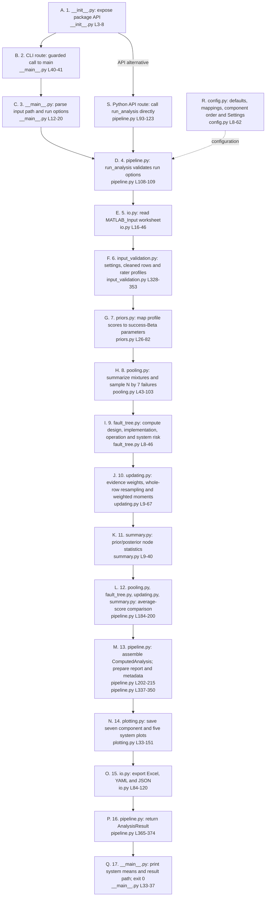

### Process-to-code reference

| ID | Process | Source lines | Clarification |
| --- | --- | --- | --- |
| A | 1. __init__.py: expose package API | [__init__.py L3-8](https://github.com/ykwang6126/Launch-Vehicle-Readiness-Estimation/blob/review/readability-audit/src/__init__.py#L3) |  |
| B | 2. CLI route: guarded call to main | [__main__.py L40-41](https://github.com/ykwang6126/Launch-Vehicle-Readiness-Estimation/blob/review/readability-audit/src/__main__.py#L40) |  |
| C | 3. __main__.py: parse input path and run options | [__main__.py L12-20](https://github.com/ykwang6126/Launch-Vehicle-Readiness-Estimation/blob/review/readability-audit/src/__main__.py#L12) |  |
| D | 4. pipeline.py: run_analysis validates run options | [pipeline.py L108-109](https://github.com/ykwang6126/Launch-Vehicle-Readiness-Estimation/blob/review/readability-audit/src/pipeline.py#L108) |  |
| E | 5. io.py: read MATLAB_Input worksheet | [io.py L16-46](https://github.com/ykwang6126/Launch-Vehicle-Readiness-Estimation/blob/review/readability-audit/src/io.py#L16) |  |
| F | 6. input_validation.py: settings, cleaned rows and rater profiles | [input_validation.py L328-353](https://github.com/ykwang6126/Launch-Vehicle-Readiness-Estimation/blob/review/readability-audit/src/input_validation.py#L328) |  |
| G | 7. priors.py: map profile scores to success-Beta parameters | [priors.py L26-82](https://github.com/ykwang6126/Launch-Vehicle-Readiness-Estimation/blob/review/readability-audit/src/priors.py#L26) |  |
| H | 8. pooling.py: summarize mixtures and sample N by 7 failures | [pooling.py L43-103](https://github.com/ykwang6126/Launch-Vehicle-Readiness-Estimation/blob/review/readability-audit/src/pooling.py#L43) |  |
| I | 9. fault_tree.py: compute design, implementation, operation and system risk | [fault_tree.py L8-46](https://github.com/ykwang6126/Launch-Vehicle-Readiness-Estimation/blob/review/readability-audit/src/fault_tree.py#L8) |  |
| J | 10. updating.py: evidence weights, whole-row resampling and weighted moments | [updating.py L9-67](https://github.com/ykwang6126/Launch-Vehicle-Readiness-Estimation/blob/review/readability-audit/src/updating.py#L9) |  |
| K | 11. summary.py: prior/posterior node statistics | [summary.py L9-40](https://github.com/ykwang6126/Launch-Vehicle-Readiness-Estimation/blob/review/readability-audit/src/summary.py#L9) |  |
| L | 12. pooling.py, fault_tree.py, updating.py, summary.py: average-score comparison | [pipeline.py L184-200](https://github.com/ykwang6126/Launch-Vehicle-Readiness-Estimation/blob/review/readability-audit/src/pipeline.py#L184) |  |
| M | 13. pipeline.py: assemble ComputedAnalysis; prepare report and metadata | [pipeline.py L202-215](https://github.com/ykwang6126/Launch-Vehicle-Readiness-Estimation/blob/review/readability-audit/src/pipeline.py#L202); [pipeline.py L337-350](https://github.com/ykwang6126/Launch-Vehicle-Readiness-Estimation/blob/review/readability-audit/src/pipeline.py#L337) |  |
| N | 14. plotting.py: save seven component and five system plots | [plotting.py L33-151](https://github.com/ykwang6126/Launch-Vehicle-Readiness-Estimation/blob/review/readability-audit/src/plotting.py#L33) |  |
| O | 15. io.py: export Excel, YAML and JSON | [io.py L84-120](https://github.com/ykwang6126/Launch-Vehicle-Readiness-Estimation/blob/review/readability-audit/src/io.py#L84) |  |
| P | 16. pipeline.py: return AnalysisResult | [pipeline.py L365-374](https://github.com/ykwang6126/Launch-Vehicle-Readiness-Estimation/blob/review/readability-audit/src/pipeline.py#L365) |  |
| Q | 17. __main__.py: print system means and result path; exit 0 | [__main__.py L33-37](https://github.com/ykwang6126/Launch-Vehicle-Readiness-Estimation/blob/review/readability-audit/src/__main__.py#L33) |  |
| R | config.py: defaults, mappings, component order and Settings | [config.py L8-62](https://github.com/ykwang6126/Launch-Vehicle-Readiness-Estimation/blob/review/readability-audit/src/config.py#L8) |  |
| S | Python API route: call run_analysis directly | [pipeline.py L93-123](https://github.com/ykwang6126/Launch-Vehicle-Readiness-Estimation/blob/review/readability-audit/src/pipeline.py#L93) |  |

## Package import and public API

Executed when the package is imported. Importing exposes the API; it does not call run_analysis or create output files.

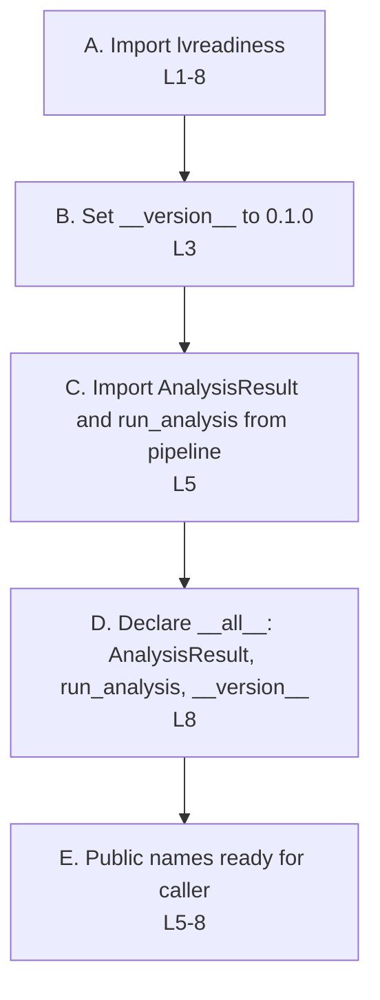

### Process-to-code reference

| ID | Process | Source lines | Clarification |
| --- | --- | --- | --- |
| A | Import lvreadiness | [__init__.py L1-8](https://github.com/ykwang6126/Launch-Vehicle-Readiness-Estimation/blob/review/readability-audit/src/__init__.py#L1) | Module entry; Python imports this file. |
| B | Set __version__ to 0.1.0 | [__init__.py L3](https://github.com/ykwang6126/Launch-Vehicle-Readiness-Estimation/blob/review/readability-audit/src/__init__.py#L3) |  |
| C | Import AnalysisResult and run_analysis from pipeline | [__init__.py L5](https://github.com/ykwang6126/Launch-Vehicle-Readiness-Estimation/blob/review/readability-audit/src/__init__.py#L5) |  |
| D | Declare __all__: AnalysisResult, run_analysis, __version__ | [__init__.py L8](https://github.com/ykwang6126/Launch-Vehicle-Readiness-Estimation/blob/review/readability-audit/src/__init__.py#L8) |  |
| E | Public names ready for caller | [__init__.py L5-8](https://github.com/ykwang6126/Launch-Vehicle-Readiness-Estimation/blob/review/readability-audit/src/__init__.py#L5) | Effect of the imports/exports above, not a separate statement. |

## __main__.py: parse, run, print

Both `lvreadiness` and `python -m lvreadiness` call `main`. The module guard at lines 40–41 runs only for module execution; importing `lvreadiness.__main__` is safe.

The CLI catches ValueError (including InputError) and OSError from analysis. Other exceptions propagate. argparse handles malformed command syntax before analysis starts.

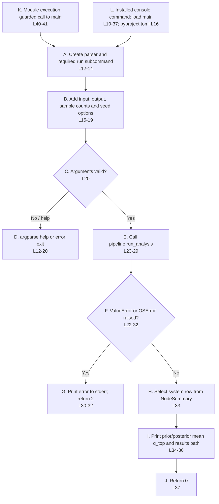

### Process-to-code reference

| ID | Process | Source lines | Clarification |
| --- | --- | --- | --- |
| A | Create parser and required run subcommand | [__main__.py L12-14](https://github.com/ykwang6126/Launch-Vehicle-Readiness-Estimation/blob/review/readability-audit/src/__main__.py#L12) |  |
| B | Add input, output, sample counts and seed options | [__main__.py L15-19](https://github.com/ykwang6126/Launch-Vehicle-Readiness-Estimation/blob/review/readability-audit/src/__main__.py#L15) |  |
| C | Arguments valid? | [__main__.py L20](https://github.com/ykwang6126/Launch-Vehicle-Readiness-Estimation/blob/review/readability-audit/src/__main__.py#L20) |  |
| D | argparse help or error exit | [__main__.py L12-20](https://github.com/ykwang6126/Launch-Vehicle-Readiness-Estimation/blob/review/readability-audit/src/__main__.py#L12) | Call site only: argparse implements help and syntax exits in the Python library. |
| E | Call pipeline.run_analysis | [__main__.py L23-29](https://github.com/ykwang6126/Launch-Vehicle-Readiness-Estimation/blob/review/readability-audit/src/__main__.py#L23) |  |
| F | ValueError or OSError raised? | [__main__.py L22-32](https://github.com/ykwang6126/Launch-Vehicle-Readiness-Estimation/blob/review/readability-audit/src/__main__.py#L22) |  |
| G | Print error to stderr; return 2 | [__main__.py L30-32](https://github.com/ykwang6126/Launch-Vehicle-Readiness-Estimation/blob/review/readability-audit/src/__main__.py#L30) |  |
| H | Select system row from NodeSummary | [__main__.py L33](https://github.com/ykwang6126/Launch-Vehicle-Readiness-Estimation/blob/review/readability-audit/src/__main__.py#L33) |  |
| I | Print prior/posterior mean q_top and results path | [__main__.py L34-36](https://github.com/ykwang6126/Launch-Vehicle-Readiness-Estimation/blob/review/readability-audit/src/__main__.py#L34) |  |
| J | Return 0 | [__main__.py L37](https://github.com/ykwang6126/Launch-Vehicle-Readiness-Estimation/blob/review/readability-audit/src/__main__.py#L37) |  |
| K | Module execution: guarded call to main | [__main__.py L40-41](https://github.com/ykwang6126/Launch-Vehicle-Readiness-Estimation/blob/review/readability-audit/src/__main__.py#L40) | Runs for `python -m lvreadiness`; importing the module leaves the guard false. |
| L | Installed console command: load main | [__main__.py L10-37](https://github.com/ykwang6126/Launch-Vehicle-Readiness-Estimation/blob/review/readability-audit/src/__main__.py#L10); [pyproject.toml L16](https://github.com/ykwang6126/Launch-Vehicle-Readiness-Estimation/blob/review/readability-audit/pyproject.toml#L16) | The installed launcher loads the callable declared by the packaging entry point. |

## Constants, Settings and lifecycle factor

This module defines configuration, not an analysis. Settings is frozen; validation of workbook values happens in input_validation.py. A direct invalid phase lookup raises KeyError.

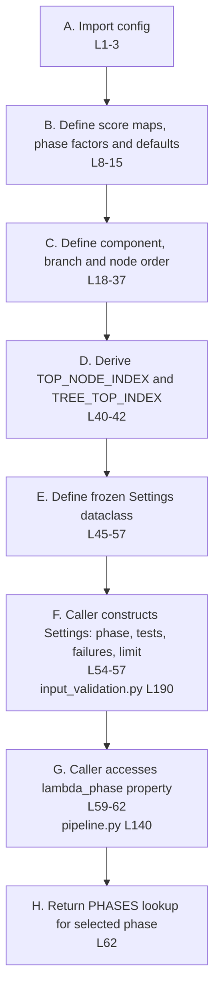

### Process-to-code reference

| ID | Process | Source lines | Clarification |
| --- | --- | --- | --- |
| A | Import config | [config.py L1-3](https://github.com/ykwang6126/Launch-Vehicle-Readiness-Estimation/blob/review/readability-audit/src/config.py#L1) | Module import/setup, not a function call in this file. |
| B | Define score maps, phase factors and defaults | [config.py L8-15](https://github.com/ykwang6126/Launch-Vehicle-Readiness-Estimation/blob/review/readability-audit/src/config.py#L8) |  |
| C | Define component, branch and node order | [config.py L18-37](https://github.com/ykwang6126/Launch-Vehicle-Readiness-Estimation/blob/review/readability-audit/src/config.py#L18) |  |
| D | Derive TOP_NODE_INDEX and TREE_TOP_INDEX | [config.py L40-42](https://github.com/ykwang6126/Launch-Vehicle-Readiness-Estimation/blob/review/readability-audit/src/config.py#L40) |  |
| E | Define frozen Settings dataclass | [config.py L45-57](https://github.com/ykwang6126/Launch-Vehicle-Readiness-Estimation/blob/review/readability-audit/src/config.py#L45) |  |
| F | Caller constructs Settings: phase, tests, failures, limit | [config.py L54-57](https://github.com/ykwang6126/Launch-Vehicle-Readiness-Estimation/blob/review/readability-audit/src/config.py#L54); [input_validation.py L190](https://github.com/ykwang6126/Launch-Vehicle-Readiness-Estimation/blob/review/readability-audit/src/input_validation.py#L190) | Fields are defined here; the input_validation.py reference is the construction site. |
| G | Caller accesses lambda_phase property | [config.py L59-62](https://github.com/ykwang6126/Launch-Vehicle-Readiness-Estimation/blob/review/readability-audit/src/config.py#L59); [pipeline.py L140](https://github.com/ykwang6126/Launch-Vehicle-Readiness-Estimation/blob/review/readability-audit/src/pipeline.py#L140) | Property definition plus an example access in pipeline.py. |
| H | Return PHASES lookup for selected phase | [config.py L62](https://github.com/ykwang6126/Launch-Vehicle-Readiness-Estimation/blob/review/readability-audit/src/config.py#L62) |  |

## pipeline.py: coordinate calculation and reporting

Solid arrows follow run_analysis. Dashed arrows identify helpers or data types used by a stage. A single seeded generator preserves draw order. Report construction draws no random samples. N prior rows and M posterior rows have 11 columns.

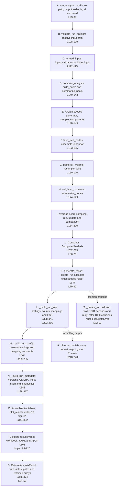

### Process-to-code reference

| ID | Process | Source lines | Clarification |
| --- | --- | --- | --- |
| A | run_analysis: workbook path, output folder, N, M and seed | [pipeline.py L93-99](https://github.com/ykwang6126/Launch-Vehicle-Readiness-Estimation/blob/review/readability-audit/src/pipeline.py#L93) |  |
| B | validate_run_options; resolve input path | [pipeline.py L108-109](https://github.com/ykwang6126/Launch-Vehicle-Readiness-Estimation/blob/review/readability-audit/src/pipeline.py#L108) |  |
| C | io.read_input; input_validation.validate_input | [pipeline.py L112-115](https://github.com/ykwang6126/Launch-Vehicle-Readiness-Estimation/blob/review/readability-audit/src/pipeline.py#L112) |  |
| D | compute_analysis: build_priors and summarize_pools | [pipeline.py L140-143](https://github.com/ykwang6126/Launch-Vehicle-Readiness-Estimation/blob/review/readability-audit/src/pipeline.py#L140) |  |
| E | Create seeded generator; sample_components | [pipeline.py L148-149](https://github.com/ykwang6126/Launch-Vehicle-Readiness-Estimation/blob/review/readability-audit/src/pipeline.py#L148) |  |
| F | fault_tree_nodes; assemble joint prior | [pipeline.py L153-155](https://github.com/ykwang6126/Launch-Vehicle-Readiness-Estimation/blob/review/readability-audit/src/pipeline.py#L153) |  |
| G | posterior_weights; resample_joint | [pipeline.py L160-170](https://github.com/ykwang6126/Launch-Vehicle-Readiness-Estimation/blob/review/readability-audit/src/pipeline.py#L160) |  |
| H | weighted_moments; summarize_nodes | [pipeline.py L174-179](https://github.com/ykwang6126/Launch-Vehicle-Readiness-Estimation/blob/review/readability-audit/src/pipeline.py#L174) |  |
| I | Average-score sampling, tree, update and comparison | [pipeline.py L184-200](https://github.com/ykwang6126/Launch-Vehicle-Readiness-Estimation/blob/review/readability-audit/src/pipeline.py#L184) |  |
| J | Construct ComputedAnalysis | [pipeline.py L202-215](https://github.com/ykwang6126/Launch-Vehicle-Readiness-Estimation/blob/review/readability-audit/src/pipeline.py#L202); [pipeline.py L56-76](https://github.com/ykwang6126/Launch-Vehicle-Readiness-Estimation/blob/review/readability-audit/src/pipeline.py#L56) |  |
| K | generate_report: _create_run allocates timestamped folder | [pipeline.py L337](https://github.com/ykwang6126/Launch-Vehicle-Readiness-Estimation/blob/review/readability-audit/src/pipeline.py#L337); [pipeline.py L79-90](https://github.com/ykwang6126/Launch-Vehicle-Readiness-Estimation/blob/review/readability-audit/src/pipeline.py#L79) |  |
| L | _build_run_info: settings, counts, mappings and ESS | [pipeline.py L338-341](https://github.com/ykwang6126/Launch-Vehicle-Readiness-Estimation/blob/review/readability-audit/src/pipeline.py#L338); [pipeline.py L223-266](https://github.com/ykwang6126/Launch-Vehicle-Readiness-Estimation/blob/review/readability-audit/src/pipeline.py#L223) |  |
| M | _build_run_config: resolved settings and mapping constants | [pipeline.py L342](https://github.com/ykwang6126/Launch-Vehicle-Readiness-Estimation/blob/review/readability-audit/src/pipeline.py#L342); [pipeline.py L269-295](https://github.com/ykwang6126/Launch-Vehicle-Readiness-Estimation/blob/review/readability-audit/src/pipeline.py#L269) |  |
| N | _build_run_metadata: versions, Git SHA, input hash and diagnostics | [pipeline.py L343](https://github.com/ykwang6126/Launch-Vehicle-Readiness-Estimation/blob/review/readability-audit/src/pipeline.py#L343); [pipeline.py L298-317](https://github.com/ykwang6126/Launch-Vehicle-Readiness-Estimation/blob/review/readability-audit/src/pipeline.py#L298) |  |
| O | Assemble five tables; plot_results writes 12 figures | [pipeline.py L344-362](https://github.com/ykwang6126/Launch-Vehicle-Readiness-Estimation/blob/review/readability-audit/src/pipeline.py#L344) |  |
| P | export_results writes workbook, YAML and JSON | [pipeline.py L363](https://github.com/ykwang6126/Launch-Vehicle-Readiness-Estimation/blob/review/readability-audit/src/pipeline.py#L363); [io.py L84-120](https://github.com/ykwang6126/Launch-Vehicle-Readiness-Estimation/blob/review/readability-audit/src/io.py#L84) |  |
| Q | Return AnalysisResult with tables, paths and retained arrays | [pipeline.py L365-374](https://github.com/ykwang6126/Launch-Vehicle-Readiness-Estimation/blob/review/readability-audit/src/pipeline.py#L365); [pipeline.py L37-53](https://github.com/ykwang6126/Launch-Vehicle-Readiness-Estimation/blob/review/readability-audit/src/pipeline.py#L37) |  |
| R | _format_matlab_array: format mappings for RunInfo | [pipeline.py L218-220](https://github.com/ykwang6126/Launch-Vehicle-Readiness-Estimation/blob/review/readability-audit/src/pipeline.py#L218) |  |
| S | _create_run collision: wait 0.001 seconds and retry; after 1000 collisions raise FileExistsError | [pipeline.py L82-90](https://github.com/ykwang6126/Launch-Vehicle-Readiness-Estimation/blob/review/readability-audit/src/pipeline.py#L82) |  |

## input_validation.py: workbook rows to validated rater profiles

The main path is validate_input. Invalid settings and assessment checks raise InputError, a ValueError subclass, at the first failure. Dashed arrows identify helper routines. The warning is emitted only after every validation stage succeeds.

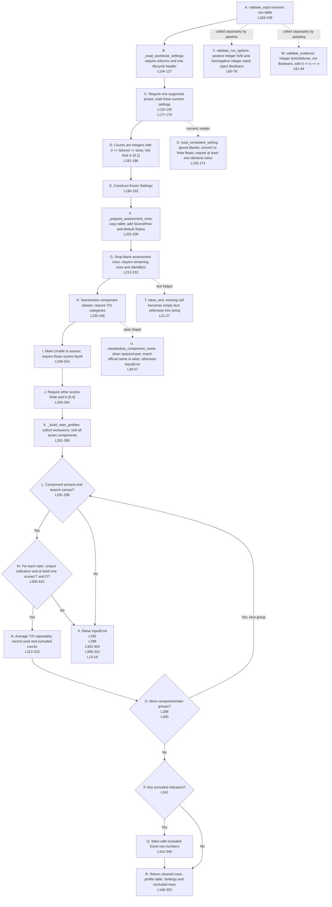

### Process-to-code reference

| ID | Process | Source lines | Clarification |
| --- | --- | --- | --- |
| A | validate_input receives raw table | [input_validation.py L328-338](https://github.com/ykwang6126/Launch-Vehicle-Readiness-Estimation/blob/review/readability-audit/src/input_validation.py#L328) |  |
| B | _read_workbook_settings: require columns and one lifecycle header | [input_validation.py L104-127](https://github.com/ykwang6126/Launch-Vehicle-Readiness-Estimation/blob/review/readability-audit/src/input_validation.py#L104) |  |
| C | Require one supported phase; read three numeric settings | [input_validation.py L132-145](https://github.com/ykwang6126/Launch-Vehicle-Readiness-Estimation/blob/review/readability-audit/src/input_validation.py#L132); [input_validation.py L177-179](https://github.com/ykwang6126/Launch-Vehicle-Readiness-Estimation/blob/review/readability-audit/src/input_validation.py#L177) |  |
| D | Counts are integers with 0 <= failures <= tests; risk limit in [0,1] | [input_validation.py L181-186](https://github.com/ykwang6126/Launch-Vehicle-Readiness-Estimation/blob/review/readability-audit/src/input_validation.py#L181) |  |
| E | Construct frozen Settings | [input_validation.py L190-192](https://github.com/ykwang6126/Launch-Vehicle-Readiness-Estimation/blob/review/readability-audit/src/input_validation.py#L190) |  |
| F | _prepare_assessment_rows: copy table; add SourceRow and default Status | [input_validation.py L202-209](https://github.com/ykwang6126/Launch-Vehicle-Readiness-Estimation/blob/review/readability-audit/src/input_validation.py#L202) |  |
| G | Drop blank assessment rows; require remaining rows and identifiers | [input_validation.py L212-232](https://github.com/ykwang6126/Launch-Vehicle-Readiness-Estimation/blob/review/readability-audit/src/input_validation.py#L212) |  |
| H | Standardize component aliases; require T/O categories | [input_validation.py L235-246](https://github.com/ykwang6126/Launch-Vehicle-Readiness-Estimation/blob/review/readability-audit/src/input_validation.py#L235) |  |
| I | Mark Unable to assess; require those scores blank | [input_validation.py L249-254](https://github.com/ykwang6126/Launch-Vehicle-Readiness-Estimation/blob/review/readability-audit/src/input_validation.py#L249) |  |
| J | Require other scores finite and in [0,4] | [input_validation.py L256-264](https://github.com/ykwang6126/Launch-Vehicle-Readiness-Estimation/blob/review/readability-audit/src/input_validation.py#L256) |  |
| K | _build_rater_profiles: collect exclusions; visit all seven components | [input_validation.py L281-289](https://github.com/ykwang6126/Launch-Vehicle-Readiness-Estimation/blob/review/readability-audit/src/input_validation.py#L281) |  |
| L | Component present and branch correct? | [input_validation.py L291-298](https://github.com/ykwang6126/Launch-Vehicle-Readiness-Estimation/blob/review/readability-audit/src/input_validation.py#L291) |  |
| M | For each rater: unique indicators and at least one scored T and O? | [input_validation.py L300-310](https://github.com/ykwang6126/Launch-Vehicle-Readiness-Estimation/blob/review/readability-audit/src/input_validation.py#L300) |  |
| N | Average T/O separately; record used and excluded counts | [input_validation.py L312-323](https://github.com/ykwang6126/Launch-Vehicle-Readiness-Estimation/blob/review/readability-audit/src/input_validation.py#L312) |  |
| O | More component/rater groups? | [input_validation.py L288](https://github.com/ykwang6126/Launch-Vehicle-Readiness-Estimation/blob/review/readability-audit/src/input_validation.py#L288); [input_validation.py L300](https://github.com/ykwang6126/Launch-Vehicle-Readiness-Estimation/blob/review/readability-audit/src/input_validation.py#L300) | These for-loop headers control continuation; no separate 'more groups' statement exists. |
| P | Any excluded indicators? | [input_validation.py L341](https://github.com/ykwang6126/Launch-Vehicle-Readiness-Estimation/blob/review/readability-audit/src/input_validation.py#L341) |  |
| Q | Warn with excluded Excel row numbers | [input_validation.py L342-346](https://github.com/ykwang6126/Launch-Vehicle-Readiness-Estimation/blob/review/readability-audit/src/input_validation.py#L342) |  |
| R | Return cleaned rows, profile table, Settings and excluded rows | [input_validation.py L348-353](https://github.com/ykwang6126/Launch-Vehicle-Readiness-Estimation/blob/review/readability-audit/src/input_validation.py#L348) |  |
| X | Raise InputError | [input_validation.py L292](https://github.com/ykwang6126/Launch-Vehicle-Readiness-Estimation/blob/review/readability-audit/src/input_validation.py#L292); [input_validation.py L298](https://github.com/ykwang6126/Launch-Vehicle-Readiness-Estimation/blob/review/readability-audit/src/input_validation.py#L298); [input_validation.py L302-304](https://github.com/ykwang6126/Launch-Vehicle-Readiness-Estimation/blob/review/readability-audit/src/input_validation.py#L302); [input_validation.py L308-310](https://github.com/ykwang6126/Launch-Vehicle-Readiness-Estimation/blob/review/readability-audit/src/input_validation.py#L308); [input_validation.py L13-18](https://github.com/ykwang6126/Launch-Vehicle-Readiness-Estimation/blob/review/readability-audit/src/input_validation.py#L13) |  |
| S | read_consistent_setting: ignore blanks; convert to finite floats; require at least one identical value | [input_validation.py L155-174](https://github.com/ykwang6126/Launch-Vehicle-Readiness-Estimation/blob/review/readability-audit/src/input_validation.py#L155) |  |
| T | clean_text: missing cell becomes empty text; otherwise trim string | [input_validation.py L21-27](https://github.com/ykwang6126/Launch-Vehicle-Readiness-Estimation/blob/review/readability-audit/src/input_validation.py#L21) |  |
| U | standardize_component_name: clean spaces/case; match official name or alias; otherwise InputError | [input_validation.py L30-57](https://github.com/ykwang6126/Launch-Vehicle-Readiness-Estimation/blob/review/readability-audit/src/input_validation.py#L30) |  |
| V | validate_run_options: positive integer N/M and nonnegative integer seed; reject Booleans | [input_validation.py L60-78](https://github.com/ykwang6126/Launch-Vehicle-Readiness-Estimation/blob/review/readability-audit/src/input_validation.py#L60) |  |
| W | validate_evidence: integer tests/failures, not Booleans, with 0 <= k <= n | [input_validation.py L81-94](https://github.com/ykwang6126/Launch-Vehicle-Readiness-Estimation/blob/review/readability-audit/src/input_validation.py#L81) |  |

## io.py: read input, record provenance and export results

The module offers four independent functions. The first decision is a guide to the caller's function choice, not a dispatch routine in the source. File errors generally propagate; git_commit tolerates missing Git and command failures.

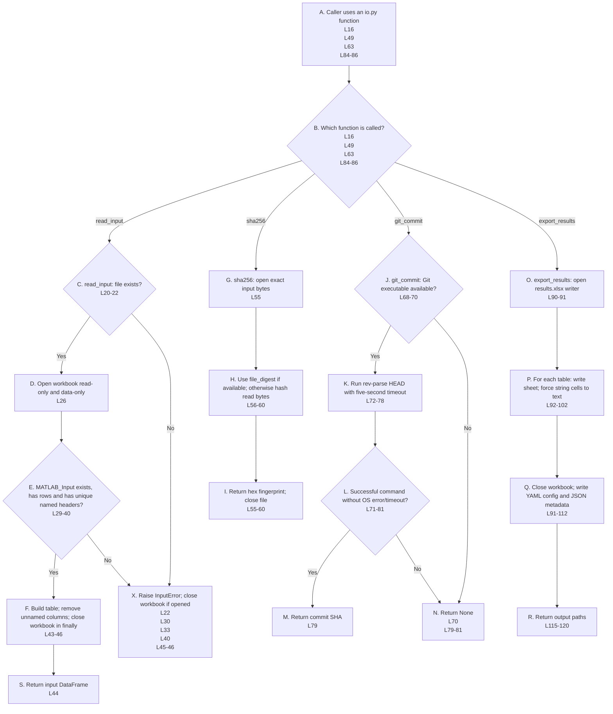

### Process-to-code reference

| ID | Process | Source lines | Clarification |
| --- | --- | --- | --- |
| A | Caller uses an io.py function | [io.py L16](https://github.com/ykwang6126/Launch-Vehicle-Readiness-Estimation/blob/review/readability-audit/src/io.py#L16); [io.py L49](https://github.com/ykwang6126/Launch-Vehicle-Readiness-Estimation/blob/review/readability-audit/src/io.py#L49); [io.py L63](https://github.com/ykwang6126/Launch-Vehicle-Readiness-Estimation/blob/review/readability-audit/src/io.py#L63); [io.py L84-86](https://github.com/ykwang6126/Launch-Vehicle-Readiness-Estimation/blob/review/readability-audit/src/io.py#L84) | Function entry signatures; navigation aid, not a runtime dispatch statement. |
| B | Which function is called? | [io.py L16](https://github.com/ykwang6126/Launch-Vehicle-Readiness-Estimation/blob/review/readability-audit/src/io.py#L16); [io.py L49](https://github.com/ykwang6126/Launch-Vehicle-Readiness-Estimation/blob/review/readability-audit/src/io.py#L49); [io.py L63](https://github.com/ykwang6126/Launch-Vehicle-Readiness-Estimation/blob/review/readability-audit/src/io.py#L63); [io.py L84-86](https://github.com/ykwang6126/Launch-Vehicle-Readiness-Estimation/blob/review/readability-audit/src/io.py#L84) | Navigation aid only: callers select these functions; no dispatcher exists in io.py. |
| C | read_input: file exists? | [io.py L20-22](https://github.com/ykwang6126/Launch-Vehicle-Readiness-Estimation/blob/review/readability-audit/src/io.py#L20) |  |
| D | Open workbook read-only and data-only | [io.py L26](https://github.com/ykwang6126/Launch-Vehicle-Readiness-Estimation/blob/review/readability-audit/src/io.py#L26) |  |
| E | MATLAB_Input exists, has rows and has unique named headers? | [io.py L29-40](https://github.com/ykwang6126/Launch-Vehicle-Readiness-Estimation/blob/review/readability-audit/src/io.py#L29) |  |
| F | Build table; remove unnamed columns; close workbook in finally | [io.py L43-46](https://github.com/ykwang6126/Launch-Vehicle-Readiness-Estimation/blob/review/readability-audit/src/io.py#L43) |  |
| G | sha256: open exact input bytes | [io.py L55](https://github.com/ykwang6126/Launch-Vehicle-Readiness-Estimation/blob/review/readability-audit/src/io.py#L55) |  |
| H | Use file_digest if available; otherwise hash read bytes | [io.py L56-60](https://github.com/ykwang6126/Launch-Vehicle-Readiness-Estimation/blob/review/readability-audit/src/io.py#L56) |  |
| I | Return hex fingerprint; close file | [io.py L55-60](https://github.com/ykwang6126/Launch-Vehicle-Readiness-Estimation/blob/review/readability-audit/src/io.py#L55) |  |
| J | git_commit: Git executable available? | [io.py L68-70](https://github.com/ykwang6126/Launch-Vehicle-Readiness-Estimation/blob/review/readability-audit/src/io.py#L68) |  |
| K | Run rev-parse HEAD with five-second timeout | [io.py L72-78](https://github.com/ykwang6126/Launch-Vehicle-Readiness-Estimation/blob/review/readability-audit/src/io.py#L72) |  |
| L | Successful command without OS error/timeout? | [io.py L71-81](https://github.com/ykwang6126/Launch-Vehicle-Readiness-Estimation/blob/review/readability-audit/src/io.py#L71) |  |
| M | Return commit SHA | [io.py L79](https://github.com/ykwang6126/Launch-Vehicle-Readiness-Estimation/blob/review/readability-audit/src/io.py#L79) |  |
| N | Return None | [io.py L70](https://github.com/ykwang6126/Launch-Vehicle-Readiness-Estimation/blob/review/readability-audit/src/io.py#L70); [io.py L79-81](https://github.com/ykwang6126/Launch-Vehicle-Readiness-Estimation/blob/review/readability-audit/src/io.py#L79) |  |
| O | export_results: open results.xlsx writer | [io.py L90-91](https://github.com/ykwang6126/Launch-Vehicle-Readiness-Estimation/blob/review/readability-audit/src/io.py#L90) |  |
| P | For each table: write sheet; force string cells to text | [io.py L92-102](https://github.com/ykwang6126/Launch-Vehicle-Readiness-Estimation/blob/review/readability-audit/src/io.py#L92) |  |
| Q | Close workbook; write YAML config and JSON metadata | [io.py L91-112](https://github.com/ykwang6126/Launch-Vehicle-Readiness-Estimation/blob/review/readability-audit/src/io.py#L91) | ExcelWriter closes when its with block ends after line 102; YAML/JSON writes are at 109-112. |
| R | Return output paths | [io.py L115-120](https://github.com/ykwang6126/Launch-Vehicle-Readiness-Estimation/blob/review/readability-audit/src/io.py#L115) |  |
| S | Return input DataFrame | [io.py L44](https://github.com/ykwang6126/Launch-Vehicle-Readiness-Estimation/blob/review/readability-audit/src/io.py#L44) |  |
| X | Raise InputError; close workbook if opened | [io.py L22](https://github.com/ykwang6126/Launch-Vehicle-Readiness-Estimation/blob/review/readability-audit/src/io.py#L22); [io.py L30](https://github.com/ykwang6126/Launch-Vehicle-Readiness-Estimation/blob/review/readability-audit/src/io.py#L30); [io.py L33](https://github.com/ykwang6126/Launch-Vehicle-Readiness-Estimation/blob/review/readability-audit/src/io.py#L33); [io.py L40](https://github.com/ykwang6126/Launch-Vehicle-Readiness-Estimation/blob/review/readability-audit/src/io.py#L40); [io.py L45-46](https://github.com/ykwang6126/Launch-Vehicle-Readiness-Estimation/blob/review/readability-audit/src/io.py#L45) |  |

## priors.py: scores to success priors and equal rater weights

build_priors calls parameters for all profile rows together. parameters is also independently callable. PriorParameters is the typed description of seven returned fields. Strength is a model confidence value, not observed test evidence.

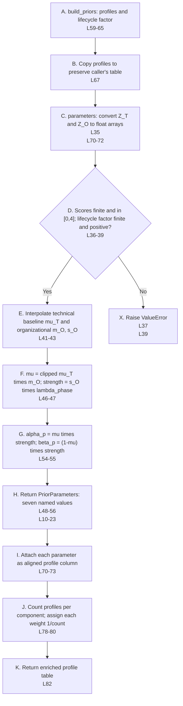

### Process-to-code reference

| ID | Process | Source lines | Clarification |
| --- | --- | --- | --- |
| A | build_priors: profiles and lifecycle factor | [priors.py L59-65](https://github.com/ykwang6126/Launch-Vehicle-Readiness-Estimation/blob/review/readability-audit/src/priors.py#L59) |  |
| B | Copy profiles to preserve caller's table | [priors.py L67](https://github.com/ykwang6126/Launch-Vehicle-Readiness-Estimation/blob/review/readability-audit/src/priors.py#L67) |  |
| C | parameters: convert Z_T and Z_O to float arrays | [priors.py L35](https://github.com/ykwang6126/Launch-Vehicle-Readiness-Estimation/blob/review/readability-audit/src/priors.py#L35); [priors.py L70-72](https://github.com/ykwang6126/Launch-Vehicle-Readiness-Estimation/blob/review/readability-audit/src/priors.py#L70) |  |
| D | Scores finite and in [0,4]; lifecycle factor finite and positive? | [priors.py L36-39](https://github.com/ykwang6126/Launch-Vehicle-Readiness-Estimation/blob/review/readability-audit/src/priors.py#L36) |  |
| E | Interpolate technical baseline mu_T and organizational m_O, s_O | [priors.py L41-43](https://github.com/ykwang6126/Launch-Vehicle-Readiness-Estimation/blob/review/readability-audit/src/priors.py#L41) |  |
| F | mu = clipped mu_T times m_O; strength = s_O times lambda_phase | [priors.py L46-47](https://github.com/ykwang6126/Launch-Vehicle-Readiness-Estimation/blob/review/readability-audit/src/priors.py#L46) |  |
| G | alpha_p = mu times strength; beta_p = (1-mu) times strength | [priors.py L54-55](https://github.com/ykwang6126/Launch-Vehicle-Readiness-Estimation/blob/review/readability-audit/src/priors.py#L54) |  |
| H | Return PriorParameters: seven named values | [priors.py L48-56](https://github.com/ykwang6126/Launch-Vehicle-Readiness-Estimation/blob/review/readability-audit/src/priors.py#L48); [priors.py L10-23](https://github.com/ykwang6126/Launch-Vehicle-Readiness-Estimation/blob/review/readability-audit/src/priors.py#L10) |  |
| I | Attach each parameter as aligned profile column | [priors.py L70-73](https://github.com/ykwang6126/Launch-Vehicle-Readiness-Estimation/blob/review/readability-audit/src/priors.py#L70) |  |
| J | Count profiles per component; assign each weight 1/count | [priors.py L78-80](https://github.com/ykwang6126/Launch-Vehicle-Readiness-Estimation/blob/review/readability-audit/src/priors.py#L78) |  |
| K | Return enriched profile table | [priors.py L82](https://github.com/ykwang6126/Launch-Vehicle-Readiness-Estimation/blob/review/readability-audit/src/priors.py#L82) |  |
| X | Raise ValueError | [priors.py L37](https://github.com/ykwang6126/Launch-Vehicle-Readiness-Estimation/blob/review/readability-audit/src/priors.py#L37); [priors.py L39](https://github.com/ykwang6126/Launch-Vehicle-Readiness-Estimation/blob/review/readability-audit/src/priors.py#L39) |  |

## pooling.py: exact mixtures, sampling and comparison

Solid arrows show sampling and reporting stages; dashed arrows are function relationships. summarize_pools runs before sample_components in the pipeline. The analytical moments helper is optional and is not part of a normal run.

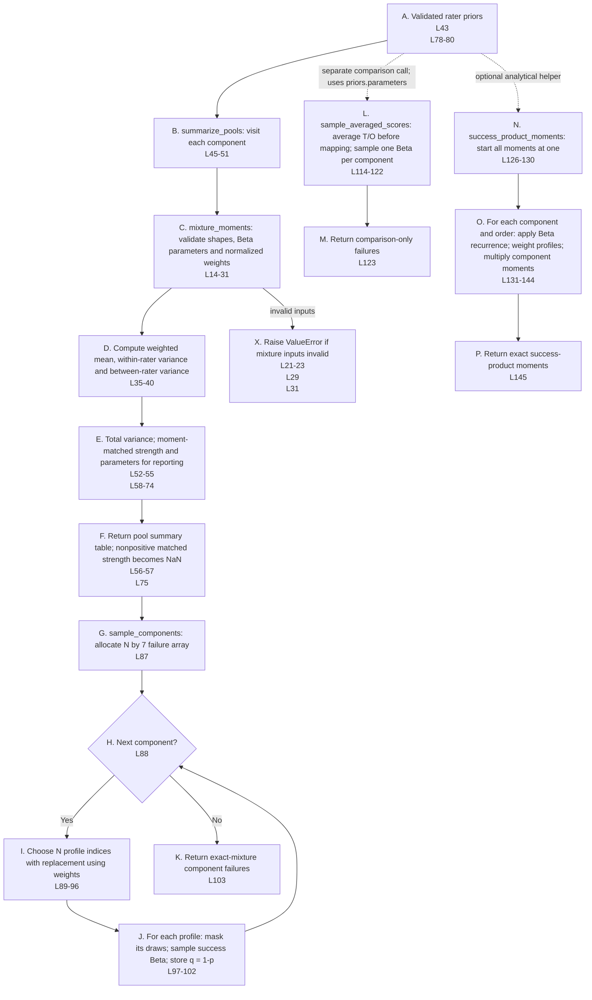

### Process-to-code reference

| ID | Process | Source lines | Clarification |
| --- | --- | --- | --- |
| A | Validated rater priors | [pooling.py L43](https://github.com/ykwang6126/Launch-Vehicle-Readiness-Estimation/blob/review/readability-audit/src/pooling.py#L43); [pooling.py L78-80](https://github.com/ykwang6126/Launch-Vehicle-Readiness-Estimation/blob/review/readability-audit/src/pooling.py#L78) | Inputs at the two primary function entry points; validation occurred earlier. |
| B | summarize_pools: visit each component | [pooling.py L45-51](https://github.com/ykwang6126/Launch-Vehicle-Readiness-Estimation/blob/review/readability-audit/src/pooling.py#L45) |  |
| C | mixture_moments: validate shapes, Beta parameters and normalized weights | [pooling.py L14-31](https://github.com/ykwang6126/Launch-Vehicle-Readiness-Estimation/blob/review/readability-audit/src/pooling.py#L14) |  |
| D | Compute weighted mean, within-rater variance and between-rater variance | [pooling.py L35-40](https://github.com/ykwang6126/Launch-Vehicle-Readiness-Estimation/blob/review/readability-audit/src/pooling.py#L35) |  |
| E | Total variance; moment-matched strength and parameters for reporting | [pooling.py L52-55](https://github.com/ykwang6126/Launch-Vehicle-Readiness-Estimation/blob/review/readability-audit/src/pooling.py#L52); [pooling.py L58-74](https://github.com/ykwang6126/Launch-Vehicle-Readiness-Estimation/blob/review/readability-audit/src/pooling.py#L58) |  |
| F | Return pool summary table; nonpositive matched strength becomes NaN | [pooling.py L56-57](https://github.com/ykwang6126/Launch-Vehicle-Readiness-Estimation/blob/review/readability-audit/src/pooling.py#L56); [pooling.py L75](https://github.com/ykwang6126/Launch-Vehicle-Readiness-Estimation/blob/review/readability-audit/src/pooling.py#L75) |  |
| G | sample_components: allocate N by 7 failure array | [pooling.py L87](https://github.com/ykwang6126/Launch-Vehicle-Readiness-Estimation/blob/review/readability-audit/src/pooling.py#L87) |  |
| H | Next component? | [pooling.py L88](https://github.com/ykwang6126/Launch-Vehicle-Readiness-Estimation/blob/review/readability-audit/src/pooling.py#L88) |  |
| I | Choose N profile indices with replacement using weights | [pooling.py L89-96](https://github.com/ykwang6126/Launch-Vehicle-Readiness-Estimation/blob/review/readability-audit/src/pooling.py#L89) |  |
| J | For each profile: mask its draws; sample success Beta; store q = 1-p | [pooling.py L97-102](https://github.com/ykwang6126/Launch-Vehicle-Readiness-Estimation/blob/review/readability-audit/src/pooling.py#L97) |  |
| K | Return exact-mixture component failures | [pooling.py L103](https://github.com/ykwang6126/Launch-Vehicle-Readiness-Estimation/blob/review/readability-audit/src/pooling.py#L103) |  |
| L | sample_averaged_scores: average T/O before mapping; sample one Beta per component | [pooling.py L114-122](https://github.com/ykwang6126/Launch-Vehicle-Readiness-Estimation/blob/review/readability-audit/src/pooling.py#L114) |  |
| M | Return comparison-only failures | [pooling.py L123](https://github.com/ykwang6126/Launch-Vehicle-Readiness-Estimation/blob/review/readability-audit/src/pooling.py#L123) |  |
| N | success_product_moments: start all moments at one | [pooling.py L126-130](https://github.com/ykwang6126/Launch-Vehicle-Readiness-Estimation/blob/review/readability-audit/src/pooling.py#L126) |  |
| O | For each component and order: apply Beta recurrence; weight profiles; multiply component moments | [pooling.py L131-144](https://github.com/ykwang6126/Launch-Vehicle-Readiness-Estimation/blob/review/readability-audit/src/pooling.py#L131) |  |
| P | Return exact success-product moments | [pooling.py L145](https://github.com/ykwang6126/Launch-Vehicle-Readiness-Estimation/blob/review/readability-audit/src/pooling.py#L145) |  |
| X | Raise ValueError if mixture inputs invalid | [pooling.py L21-23](https://github.com/ykwang6126/Launch-Vehicle-Readiness-Estimation/blob/review/readability-audit/src/pooling.py#L21); [pooling.py L29](https://github.com/ykwang6126/Launch-Vehicle-Readiness-Estimation/blob/review/readability-audit/src/pooling.py#L29); [pooling.py L31](https://github.com/ykwang6126/Launch-Vehicle-Readiness-Estimation/blob/review/readability-audit/src/pooling.py#L31) |  |

## fault_tree_nodes: combine component risks

Every branch uses OR failure logic: 1 minus the product of success probabilities. The model assumes independent component priors. This is a dependency/formula diagram, not parallel execution.

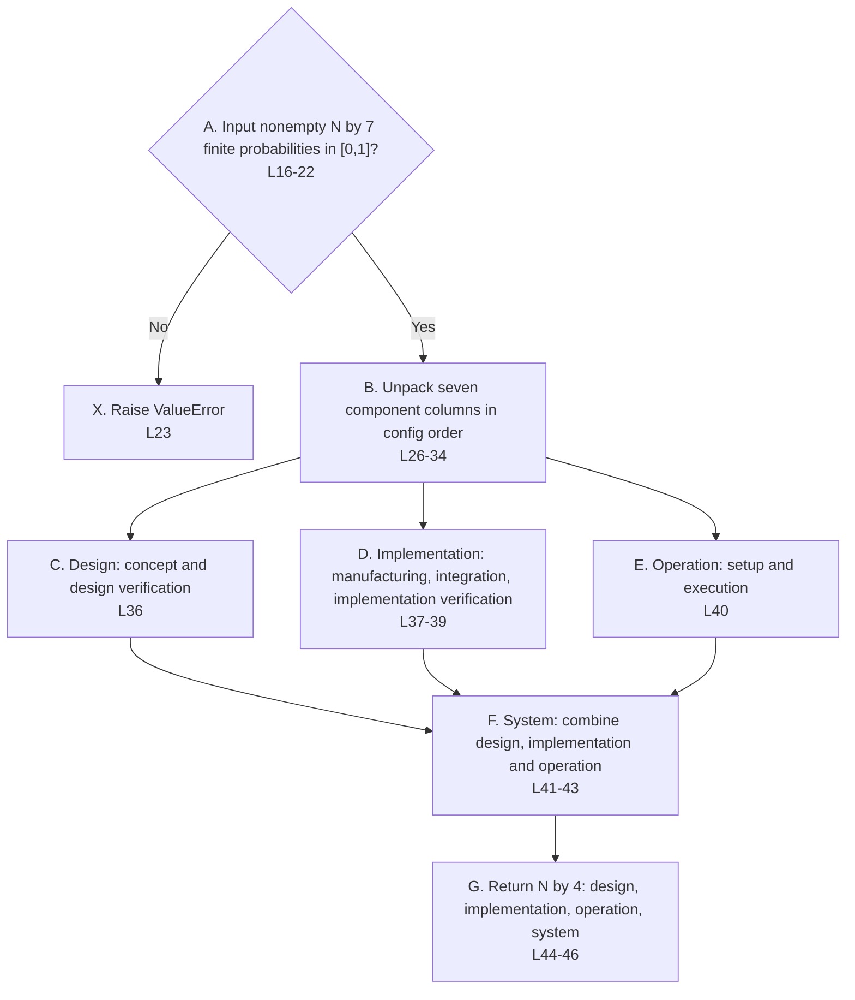

### Process-to-code reference

| ID | Process | Source lines | Clarification |
| --- | --- | --- | --- |
| A | Input nonempty N by 7 finite probabilities in [0,1]? | [fault_tree.py L16-22](https://github.com/ykwang6126/Launch-Vehicle-Readiness-Estimation/blob/review/readability-audit/src/fault_tree.py#L16) |  |
| X | Raise ValueError | [fault_tree.py L23](https://github.com/ykwang6126/Launch-Vehicle-Readiness-Estimation/blob/review/readability-audit/src/fault_tree.py#L23) |  |
| B | Unpack seven component columns in config order | [fault_tree.py L26-34](https://github.com/ykwang6126/Launch-Vehicle-Readiness-Estimation/blob/review/readability-audit/src/fault_tree.py#L26) |  |
| C | Design: concept and design verification | [fault_tree.py L36](https://github.com/ykwang6126/Launch-Vehicle-Readiness-Estimation/blob/review/readability-audit/src/fault_tree.py#L36) |  |
| D | Implementation: manufacturing, integration, implementation verification | [fault_tree.py L37-39](https://github.com/ykwang6126/Launch-Vehicle-Readiness-Estimation/blob/review/readability-audit/src/fault_tree.py#L37) |  |
| E | Operation: setup and execution | [fault_tree.py L40](https://github.com/ykwang6126/Launch-Vehicle-Readiness-Estimation/blob/review/readability-audit/src/fault_tree.py#L40) |  |
| F | System: combine design, implementation and operation | [fault_tree.py L41-43](https://github.com/ykwang6126/Launch-Vehicle-Readiness-Estimation/blob/review/readability-audit/src/fault_tree.py#L41) |  |
| G | Return N by 4: design, implementation, operation, system | [fault_tree.py L44-46](https://github.com/ykwang6126/Launch-Vehicle-Readiness-Estimation/blob/review/readability-audit/src/fault_tree.py#L44) |  |

## updating.py: test evidence to posterior samples

The pipeline calls posterior_weights, then resample_joint, then weighted_moments. The displayed order follows those calls, although each function remains independently callable. Whole-row selection preserves the joint sample relationships.

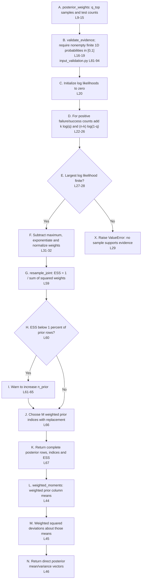

### Process-to-code reference

| ID | Process | Source lines | Clarification |
| --- | --- | --- | --- |
| A | posterior_weights: q_top samples and test counts | [updating.py L9-15](https://github.com/ykwang6126/Launch-Vehicle-Readiness-Estimation/blob/review/readability-audit/src/updating.py#L9) |  |
| B | validate_evidence; require nonempty finite 1D probabilities in [0,1] | [updating.py L16-19](https://github.com/ykwang6126/Launch-Vehicle-Readiness-Estimation/blob/review/readability-audit/src/updating.py#L16); [input_validation.py L81-94](https://github.com/ykwang6126/Launch-Vehicle-Readiness-Estimation/blob/review/readability-audit/src/input_validation.py#L81) |  |
| C | Initialize log likelihoods to zero | [updating.py L20](https://github.com/ykwang6126/Launch-Vehicle-Readiness-Estimation/blob/review/readability-audit/src/updating.py#L20) |  |
| D | For positive failure/success counts add k log(q) and (n-k) log(1-q) | [updating.py L22-26](https://github.com/ykwang6126/Launch-Vehicle-Readiness-Estimation/blob/review/readability-audit/src/updating.py#L22) |  |
| E | Largest log likelihood finite? | [updating.py L27-28](https://github.com/ykwang6126/Launch-Vehicle-Readiness-Estimation/blob/review/readability-audit/src/updating.py#L27) |  |
| F | Subtract maximum, exponentiate and normalize weights | [updating.py L31-32](https://github.com/ykwang6126/Launch-Vehicle-Readiness-Estimation/blob/review/readability-audit/src/updating.py#L31) |  |
| X | Raise ValueError: no sample supports evidence | [updating.py L29](https://github.com/ykwang6126/Launch-Vehicle-Readiness-Estimation/blob/review/readability-audit/src/updating.py#L29) |  |
| G | resample_joint: ESS = 1 / sum of squared weights | [updating.py L59](https://github.com/ykwang6126/Launch-Vehicle-Readiness-Estimation/blob/review/readability-audit/src/updating.py#L59) |  |
| H | ESS below 1 percent of prior rows? | [updating.py L60](https://github.com/ykwang6126/Launch-Vehicle-Readiness-Estimation/blob/review/readability-audit/src/updating.py#L60) |  |
| I | Warn to increase n_prior | [updating.py L61-65](https://github.com/ykwang6126/Launch-Vehicle-Readiness-Estimation/blob/review/readability-audit/src/updating.py#L61) |  |
| J | Choose M weighted prior indices with replacement | [updating.py L66](https://github.com/ykwang6126/Launch-Vehicle-Readiness-Estimation/blob/review/readability-audit/src/updating.py#L66) |  |
| K | Return complete posterior rows, indices and ESS | [updating.py L67](https://github.com/ykwang6126/Launch-Vehicle-Readiness-Estimation/blob/review/readability-audit/src/updating.py#L67) |  |
| L | weighted_moments: weighted prior column means | [updating.py L44](https://github.com/ykwang6126/Launch-Vehicle-Readiness-Estimation/blob/review/readability-audit/src/updating.py#L44) |  |
| M | Weighted squared deviations about those means | [updating.py L45](https://github.com/ykwang6126/Launch-Vehicle-Readiness-Estimation/blob/review/readability-audit/src/updating.py#L45) |  |
| N | Return direct posterior mean/variance vectors | [updating.py L46](https://github.com/ykwang6126/Launch-Vehicle-Readiness-Estimation/blob/review/readability-audit/src/updating.py#L46) |  |

## summary.py: node statistics and method comparison

The two functions are called at different points in the pipeline. This diagram places the later comparison below the main summary; summarize_nodes does not itself call pooling_comparison. Threshold statistics apply only to q_top.

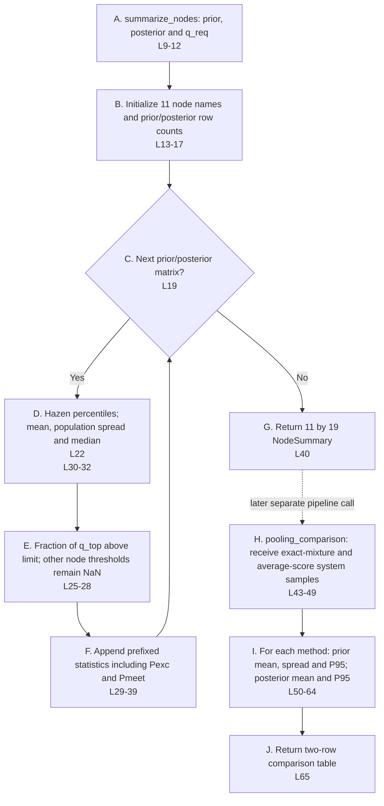

### Process-to-code reference

| ID | Process | Source lines | Clarification |
| --- | --- | --- | --- |
| A | summarize_nodes: prior, posterior and q_req | [summary.py L9-12](https://github.com/ykwang6126/Launch-Vehicle-Readiness-Estimation/blob/review/readability-audit/src/summary.py#L9) |  |
| B | Initialize 11 node names and prior/posterior row counts | [summary.py L13-17](https://github.com/ykwang6126/Launch-Vehicle-Readiness-Estimation/blob/review/readability-audit/src/summary.py#L13) |  |
| C | Next prior/posterior matrix? | [summary.py L19](https://github.com/ykwang6126/Launch-Vehicle-Readiness-Estimation/blob/review/readability-audit/src/summary.py#L19) |  |
| D | Hazen percentiles; mean, population spread and median | [summary.py L22](https://github.com/ykwang6126/Launch-Vehicle-Readiness-Estimation/blob/review/readability-audit/src/summary.py#L22); [summary.py L30-32](https://github.com/ykwang6126/Launch-Vehicle-Readiness-Estimation/blob/review/readability-audit/src/summary.py#L30) |  |
| E | Fraction of q_top above limit; other node thresholds remain NaN | [summary.py L25-28](https://github.com/ykwang6126/Launch-Vehicle-Readiness-Estimation/blob/review/readability-audit/src/summary.py#L25) |  |
| F | Append prefixed statistics including Pexc and Pmeet | [summary.py L29-39](https://github.com/ykwang6126/Launch-Vehicle-Readiness-Estimation/blob/review/readability-audit/src/summary.py#L29) |  |
| G | Return 11 by 19 NodeSummary | [summary.py L40](https://github.com/ykwang6126/Launch-Vehicle-Readiness-Estimation/blob/review/readability-audit/src/summary.py#L40) |  |
| H | pooling_comparison: receive exact-mixture and average-score system samples | [summary.py L43-49](https://github.com/ykwang6126/Launch-Vehicle-Readiness-Estimation/blob/review/readability-audit/src/summary.py#L43) |  |
| I | For each method: prior mean, spread and P95; posterior mean and P95 | [summary.py L50-64](https://github.com/ykwang6126/Launch-Vehicle-Readiness-Estimation/blob/review/readability-audit/src/summary.py#L50) |  |
| J | Return two-row comparison table | [summary.py L65](https://github.com/ykwang6126/Launch-Vehicle-Readiness-Estimation/blob/review/readability-audit/src/summary.py#L65) |  |

## plotting.py: generate all twelve figures

plot_results is the main function. Dashed arrows identify _figure and _save helpers used repeatedly. Component plots are success-probability priors; system plots use failure probabilities. Likelihood plotting never updates the posterior.

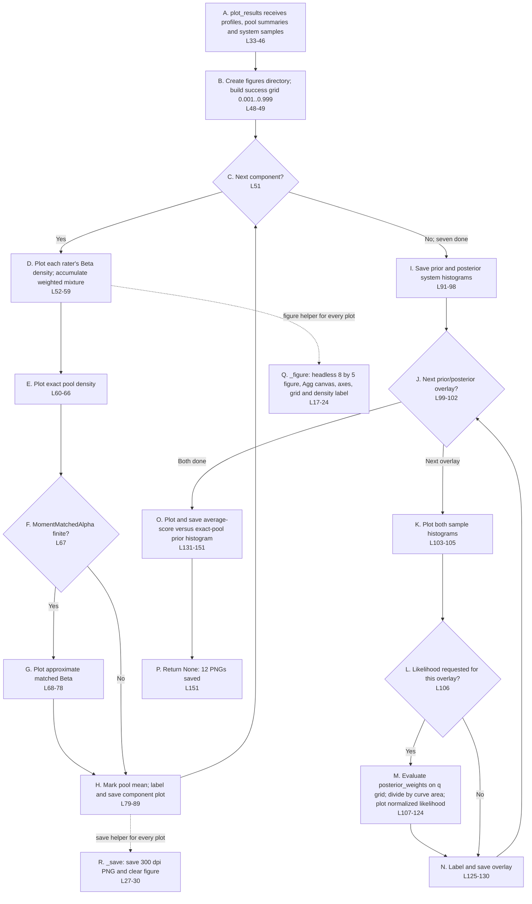

### Process-to-code reference

| ID | Process | Source lines | Clarification |
| --- | --- | --- | --- |
| A | plot_results receives profiles, pool summaries and system samples | [plotting.py L33-46](https://github.com/ykwang6126/Launch-Vehicle-Readiness-Estimation/blob/review/readability-audit/src/plotting.py#L33) |  |
| B | Create figures directory; build success grid 0.001..0.999 | [plotting.py L48-49](https://github.com/ykwang6126/Launch-Vehicle-Readiness-Estimation/blob/review/readability-audit/src/plotting.py#L48) |  |
| C | Next component? | [plotting.py L51](https://github.com/ykwang6126/Launch-Vehicle-Readiness-Estimation/blob/review/readability-audit/src/plotting.py#L51) |  |
| D | Plot each rater's Beta density; accumulate weighted mixture | [plotting.py L52-59](https://github.com/ykwang6126/Launch-Vehicle-Readiness-Estimation/blob/review/readability-audit/src/plotting.py#L52) |  |
| E | Plot exact pool density | [plotting.py L60-66](https://github.com/ykwang6126/Launch-Vehicle-Readiness-Estimation/blob/review/readability-audit/src/plotting.py#L60) |  |
| F | MomentMatchedAlpha finite? | [plotting.py L67](https://github.com/ykwang6126/Launch-Vehicle-Readiness-Estimation/blob/review/readability-audit/src/plotting.py#L67) |  |
| G | Plot approximate matched Beta | [plotting.py L68-78](https://github.com/ykwang6126/Launch-Vehicle-Readiness-Estimation/blob/review/readability-audit/src/plotting.py#L68) |  |
| H | Mark pool mean; label and save component plot | [plotting.py L79-89](https://github.com/ykwang6126/Launch-Vehicle-Readiness-Estimation/blob/review/readability-audit/src/plotting.py#L79) |  |
| I | Save prior and posterior system histograms | [plotting.py L91-98](https://github.com/ykwang6126/Launch-Vehicle-Readiness-Estimation/blob/review/readability-audit/src/plotting.py#L91) |  |
| J | Next prior/posterior overlay? | [plotting.py L99-102](https://github.com/ykwang6126/Launch-Vehicle-Readiness-Estimation/blob/review/readability-audit/src/plotting.py#L99) |  |
| K | Plot both sample histograms | [plotting.py L103-105](https://github.com/ykwang6126/Launch-Vehicle-Readiness-Estimation/blob/review/readability-audit/src/plotting.py#L103) |  |
| L | Likelihood requested for this overlay? | [plotting.py L106](https://github.com/ykwang6126/Launch-Vehicle-Readiness-Estimation/blob/review/readability-audit/src/plotting.py#L106) |  |
| M | Evaluate posterior_weights on q grid; divide by curve area; plot normalized likelihood | [plotting.py L107-124](https://github.com/ykwang6126/Launch-Vehicle-Readiness-Estimation/blob/review/readability-audit/src/plotting.py#L107) |  |
| N | Label and save overlay | [plotting.py L125-130](https://github.com/ykwang6126/Launch-Vehicle-Readiness-Estimation/blob/review/readability-audit/src/plotting.py#L125) |  |
| O | Plot and save average-score versus exact-pool prior histogram | [plotting.py L131-151](https://github.com/ykwang6126/Launch-Vehicle-Readiness-Estimation/blob/review/readability-audit/src/plotting.py#L131) |  |
| P | Return None: 12 PNGs saved | [plotting.py L151](https://github.com/ykwang6126/Launch-Vehicle-Readiness-Estimation/blob/review/readability-audit/src/plotting.py#L151) | The final save is line 151; None is returned implicitly at the function end. |
| Q | _figure: headless 8 by 5 figure, Agg canvas, axes, grid and density label | [plotting.py L17-24](https://github.com/ykwang6126/Launch-Vehicle-Readiness-Estimation/blob/review/readability-audit/src/plotting.py#L17) |  |
| R | _save: save 300 dpi PNG and clear figure | [plotting.py L27-30](https://github.com/ykwang6126/Launch-Vehicle-Readiness-Estimation/blob/review/readability-audit/src/plotting.py#L27) |  |
